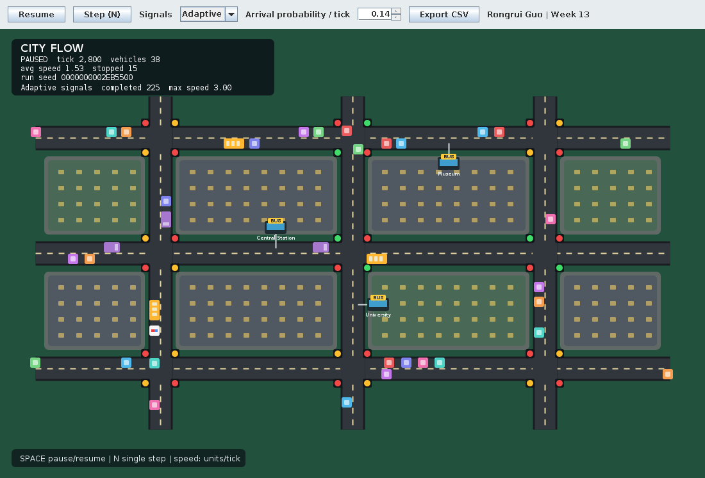

# COMP2000 — Traffic Simulation

**Week 13 individual extension · Rongrui Guo · 48977152**

A Java traffic simulation with a Swing interface, a nine-intersection road network, traffic lights, cars, trucks, buses and emergency vehicles. This individual fork extends the original group project with interactive controls, switchable signal timing, statistics collection, CSV export and regression tests.

- [Individual repository](https://github.com/rongruiguo-cell/COMP2000---Object-Oriented-Programming)
- [Original group repository](https://github.com/CalHo1/COMP2000---Object-Oriented-Programming)
- [Original README and team credits](docs/README-original.md)



## Requirements

- **JDK 17 or newer**, with `java` and `javac` available on `PATH`.
- A desktop environment for the GUI; headless execution is also supported.
- Only the Java standard library is used. No Maven, Gradle or external libraries are required.

Check the installation in a new terminal:

```text
java -version
javac -version
```

## Build and run

Clone this repository, or download and fully extract its ZIP. Run the following commands from the project root.

### Windows — Command Prompt

```bat
build.bat
run.bat
```

You can also double-click `run.bat`. It builds the JAR automatically if `dist/traffic-simulation.jar` is missing. After editing the source, run `build.bat` again before launching. In PowerShell, use `./build.bat` and `./run.bat`.

### macOS / Linux

```sh
sh build.sh
sh run.sh
```

The build creates `dist/traffic-simulation.jar`. Generated `build/` and `dist/` files are excluded from Git, so a fresh checkout requires a JDK to compile the project.

For a repeatable run, after building:

```text
java -jar dist/traffic-simulation.jar --seed=48977152
```

Without `--seed`, each launch generates a new seed. The default network is `networks/grid.txt`; if it is absent, the program uses the built-in network. An alternative network file can be supplied as the first positional argument.

## Controls

| Control | Action |
|---|---|
| Pause / Resume or Space | Pause or resume the simulation |
| Step (N) or N | Advance one tick while paused |
| Signals | Switch between Adaptive and Fixed signal timing |
| Arrival probability / tick | Adjust the probability of an arrival request; default: 0.06 |
| Export CSV | Save recorded statistics; the GUI asks before replacing an existing file |

The original 1100 × 700 city view is retained, with a toolbar above it. The dashboard includes vehicle counts, speed statistics, completed journeys and the selected timing policy. Speeds use simulation units per tick, not km/h. The dashboard displays the seed in hexadecimal; `--seed` accepts a decimal Java `long`.

## Original project and individual extensions

The group project's road network, vehicle hierarchy, bus stops, traffic sensors, emergency-vehicle behaviour, State classes and Observer interface are retained. These existing components are credited to the original project.

The Week 13 extension adds:

- Pause/resume controls, single-step execution, timing selection and adjustable arrival probability.
- A `SignalTimingStrategy` interface that separates the existing adaptive green-extension rule from the new fixed-timing option.
- A `MetricsRecorder` observer, immutable metric snapshots and CSV export.
- A custom stream collector for vehicle counts, average/maximum speed, stopped vehicles and per-type statistics.
- Headless execution and a sequential comparison runner for repeatable experiments.
- Build scripts, regression tests, design diagrams and supporting documentation.

All 33 original production Java files remain at their original paths: 27 are unchanged and six are modified. Nine production Java files are added, giving 42 in total. See [source changes](docs/source-changes.md) for the detailed comparison.

## Design and concurrency

| Concept | Implementation |
|---|---|
| Observer | Existing `SimulationObserver` and display observer, extended with `MetricsRecorder` |
| State | Existing `TrafficLight`, `LightState`, `RedState`, `GreenState` and `YellowState` |
| Strategy | `SignalTimingStrategy`, `AdaptiveSignalTiming` and `FixedSignalTiming` |
| Streams and lambdas | Statistics aggregation, custom collector and GUI event handlers |
| Immutable records | Metric values copied from the simulation for reporting and reduction |
| Thread coordination | Background simulation loop, lock-protected updates, pause and single-step operations |

The simulation itself is updated sequentially. Parallel reduction is tested on copied immutable statistics, rather than mutable vehicles. Full experiments also run sequentially because the original vehicle implementation shares a static random source.

## Tests and experiments

Run the regression suite from the project root:

```bat
test.bat
```

On macOS / Linux, use `sh test.sh`. On Windows, run the test command in an open terminal so that the results remain visible.

The recorded Linux / OpenJDK 17 validation passed **10 test groups with 769,104 assertions**. Most assertions are repeated checks over simulation ticks, not separate test cases. Default vehicle and signal traces matched the original source for three seeds over 3,000 ticks each. See the [test report](docs/test-report.md) and [baseline comparison](docs/baseline-verification.json) for details and scope.

On 4 November 2026, the project owner also reported successful GUI operation and test execution on Windows after installing Temurin JDK 17. The detailed archived test report describes the earlier Linux validation.

After building, run headless simulations or the policy comparison:

```text
java -jar dist/traffic-simulation.jar --headless --ticks=3000 --seed=48977152 --csv=metrics.csv
java -jar dist/traffic-simulation.jar --headless --ticks=5000 --seed=42 --timing=fixed --spawn=0.14
java -cp dist/traffic-simulation.jar trafficsim.ComparisonRunner 5000 comparison.csv
```

The comparison runs three seeds × three arrival probabilities × two timing policies, producing 18 sequential experiments. Existing results are in [comparison.csv](docs/comparison.csv), with interpretation in the [experiment summary](docs/experiment-summary.md). Adaptive timing does not consistently outperform fixed timing in every tested scenario.

## Project files and documentation

| Path | Purpose |
|---|---|
| `src/trafficsim/` | Production Java code |
| `networks/grid.txt` | Original nine-intersection network |
| `tests/` | Regression tests, baseline trace and preview renderer |
| [Architecture](docs/architecture.md) | Structure and responsibilities |
| [Design patterns PDF](docs/design-patterns.pdf) | Observer, State and Strategy diagrams |
| [Week 13 worksheet](docs/worksheet-13.md) | Technical answers and personal reflection draft |
| [Weeks 7–13 logbook](docs/logbook-weeks7-13.md) | Template to complete with actual activities and evidence |
| [Source changes](docs/source-changes.md) | Existing and added functionality |
| [Source provenance](docs/source-provenance.json) | Hashes recorded when the original-source extension package was prepared; later documentation edits may differ |
| [Demo script](docs/demo-script.md) | Suggested demonstration sequence |
| [Sample statistics](docs/sample-statistics.csv) | Recorded headless-run data |
| `team contract`, `trafficsimulationuml.drawio` | Preserved group-project materials |

The individual extension was pushed to this fork in commit [`af92ca9`](https://github.com/rongruiguo-cell/COMP2000---Object-Oriented-Programming/commit/af92ca9). Personal logbook entries, Week 7 feedback and reflection still need to be completed and checked against actual experience before assessment submission.

## Model limitations

Traffic moves straight through intersections; turning and lane changes are not implemented. Emergency vehicles retain the original red-light exemption and sensor-based yielding behaviour. Signal states use timers, while `TrafficSensor` checks intersection occupancy and conflicts.

GUI statistics are sampled every ten ticks and retain up to 6,000 regular samples, with the current tick included on export. Mean completed-trip duration excludes vehicles still travelling. This is a simplified teaching simulation, not a validated model of real-world traffic.

## AI use acknowledgement

The original project included an AI-use acknowledgement, preserved in [the original README](docs/README-original.md). Generative AI assistance was also used to prepare the individual extensions, tests and documentation. The submitting student remains responsible for checking the work, understanding and explaining the implementation, completing personal reflections accurately and following the unit's disclosure requirements.
